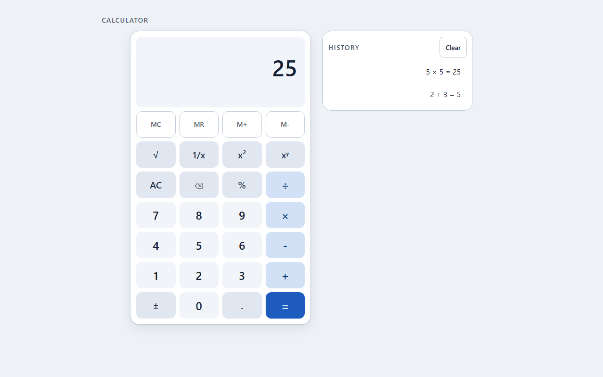
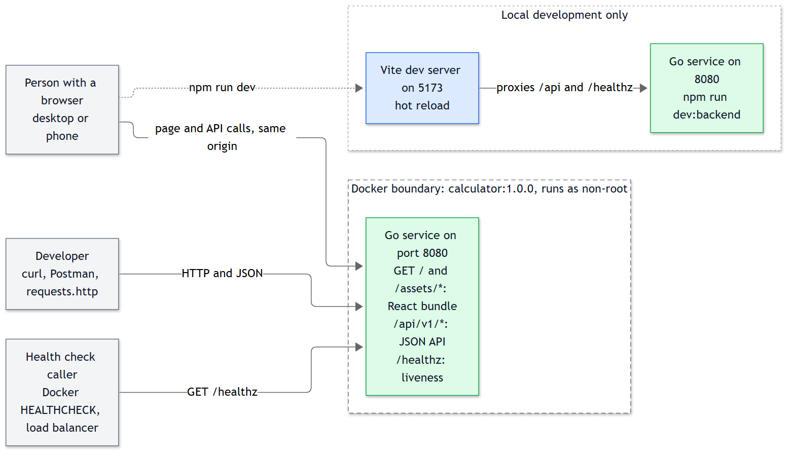
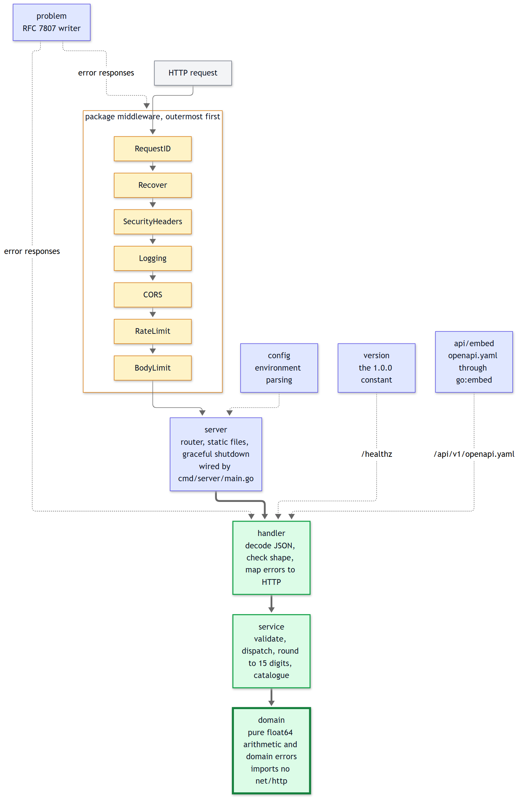
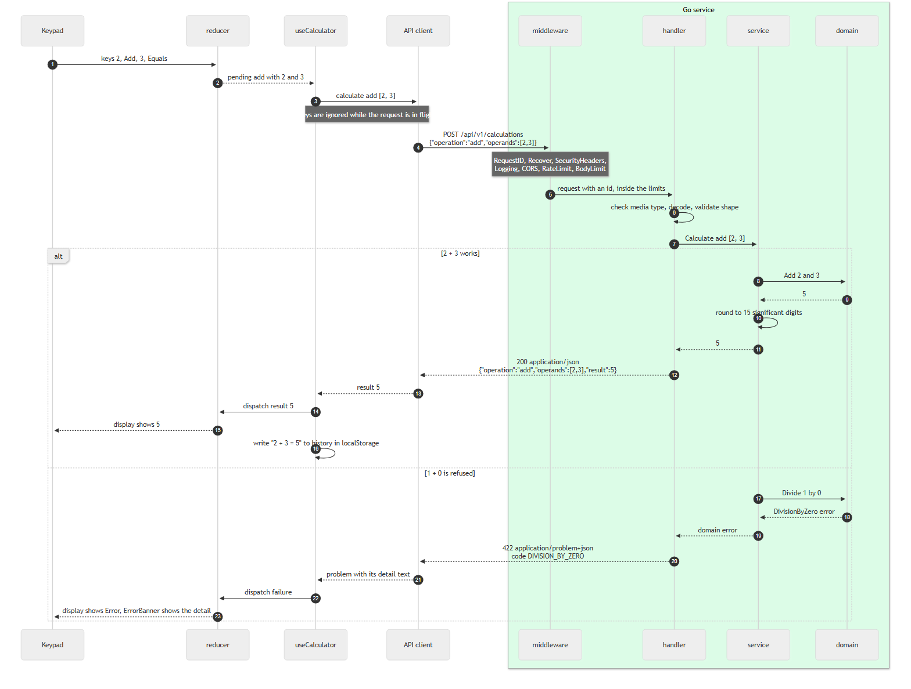
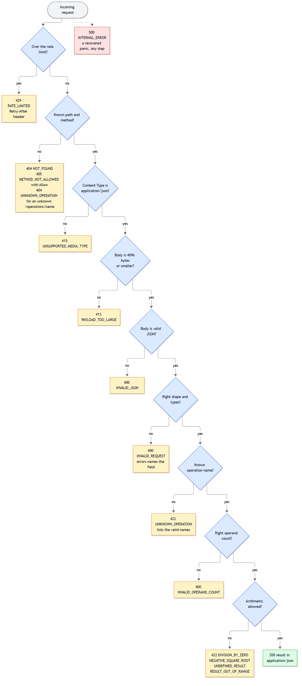
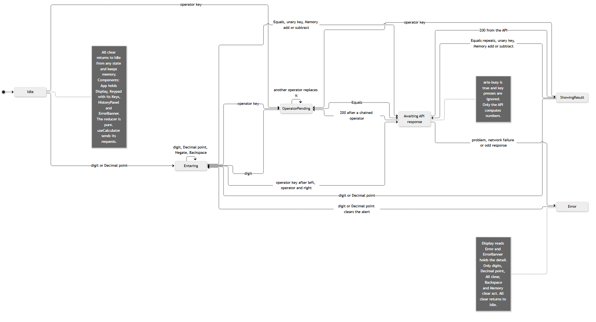
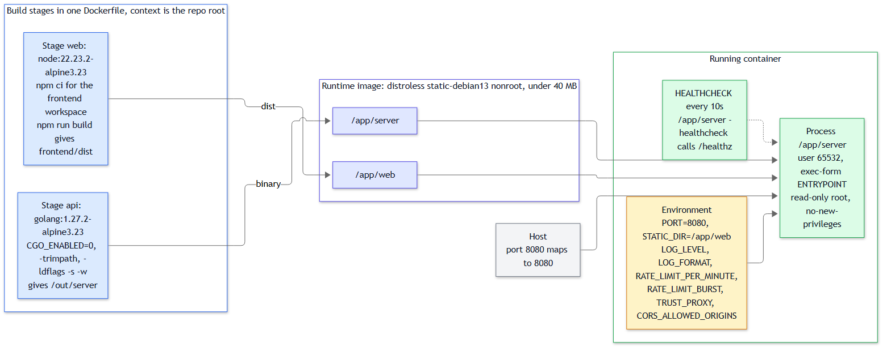
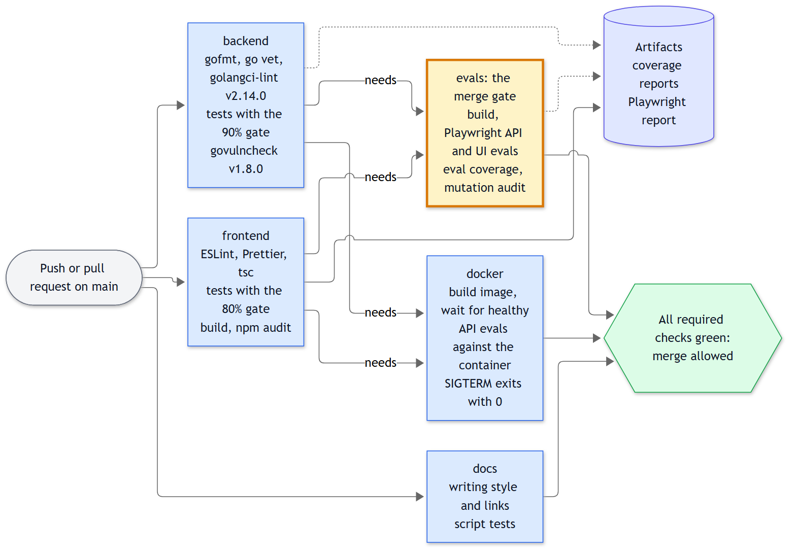
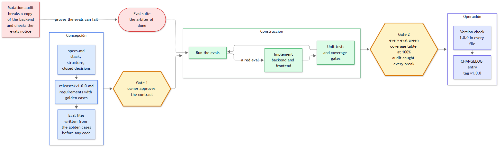

# Calculator

A full-stack calculator. A Go service does the arithmetic behind a versioned REST API. A React keypad talks to it. One Docker image runs both.



## What it is

The backend is Go with the standard library only, so it has no runtime dependencies. The frontend is React 19 and TypeScript in strict mode.

All arithmetic happens on the server. The frontend edits number strings, calls the API and shows what comes back. That includes the memory keys: `M+` and `M-` call `add` and `subtract` on the server.

Nine operations: add, subtract, multiply, divide, power, square root, percentage, reciprocal and square. The keypad also has chained calculations, repeat-equals, four memory keys and a history of the last 50 results.

It started as a take-home assessment, so the tests, the docs and the design notes matter as much as the features.

## Quick start

### With Docker

```bash
docker build -t calculator:1.0.0 .
docker run --rm -p 8080:8080 calculator:1.0.0
```

Open http://localhost:8080. `docker compose up --build` does the same thing.

The image runs as a non-root user and its health check calls the binary itself, because the runtime layer has no shell or curl.

### Local development

You need Go 1.27.0, Node 22.23.2 (the version in `.nvmrc`) and npm 10.

```bash
npm ci
npm run dev
```

The backend listens on :8080 and Vite on :5173. Open http://localhost:5173. Vite proxies `/api` and `/healthz` to the backend.

### Production build without Docker

```bash
npm run build
npm start
```

`npm start` runs the Go binary with `STATIC_DIR` pointing at `frontend/dist`, so one process serves the page and the API on :8080.

On Windows, a shell that was open before you installed Go may not find it. Open a new shell or add `C:\Program Files\Go\bin` to `PATH`.

## Project layout

```
backend/        Go service: cmd/server, internal/{config,domain,service,handler,middleware,problem,server,version}
  api/          openapi.yaml, the HTTP contract (embedded in the binary)
frontend/       React + TypeScript app (Vite)
evals/          Playwright eval suite, one file per requirement in releases/v1.0.0.md
scripts/        Node helpers behind the npm scripts
docs/           diagrams, screenshots, coverage snapshot, ERROR-CONTRACT.md
releases/       the v1.0.0 requirements with golden cases
specs.md        stack, structure and closed decisions
```

`CLAUDE.md` and `AGENTS.md` hold the conventions for AI agents. `RELEASING.md`, `BACKLOG.md` and `CHANGELOG.md` cover the release process.

## Architecture

The Go binary serves the React bundle and the API from one port. In development Vite takes the page and proxies API calls.



Handlers do HTTP and nothing else. The service validates, picks the operation, rounds and checks the result. The domain holds pure arithmetic and never imports `net/http`.



This is what happens when you press `2 + 3 =`, and what happens when you press `1 ÷ 0 =`.



Every error leaves the service as Problem Details. The validation order decides which code a bad request gets.



The calculator is a pure reducer. The hook around it performs API calls and reports successes to the history.



The Docker build has three stages and ships a small image.



## API reference

Base path `/api/v1`. The full contract is [backend/api/openapi.yaml](backend/api/openapi.yaml), and the running service serves the same file at `GET /api/v1/openapi.yaml`. Ready-made requests are in [requests.http](requests.http) and [postman_collection.json](postman_collection.json).

| Method and path | What it does |
|-----------------|--------------|
| `POST /api/v1/calculations` | Runs one operation. Body: `{"operation": "...", "operands": [...]}` |
| `GET /api/v1/operations` | Lists the nine operations with symbol, arity and description |
| `POST /api/v1/operations/{name}` | Same as above with the operation in the path. Body: `{"operands": [...]}` |
| `GET /api/v1/openapi.yaml` | The OpenAPI document |
| `GET /healthz` | Liveness check. Returns the status and version |

Operation names: `add`, `subtract`, `multiply`, `divide`, `power`, `sqrt`, `percentage`, `reciprocal`, `square`. Names are lowercase and case-sensitive. `sqrt`, `reciprocal` and `square` take one operand. The rest take two.

```bash
curl -s -X POST http://localhost:8080/api/v1/calculations \
  -H "Content-Type: application/json" \
  -d '{"operation":"add","operands":[0.1,0.2]}'
```

```json
{ "operation": "add", "operands": [0.1, 0.2], "result": 0.3 }
```

In PowerShell:

```powershell
Invoke-RestMethod -Method Post -Uri http://localhost:8080/api/v1/operations/sqrt `
  -ContentType application/json -Body '{"operands":[9]}'
```

Percentage means "a percent of b". `15` and `200` give `30`.

### Errors

Every error is `application/problem+json` (RFC 7807) with a stable `code` and the same `requestId` as the `X-Request-Id` header.

```bash
curl -i -X POST http://localhost:8080/api/v1/calculations \
  -H "Content-Type: application/json" \
  -d '{"operation":"divide","operands":[5,0]}'
```

```json
{
  "type": "about:blank",
  "title": "Unprocessable Entity",
  "status": 422,
  "detail": "Division by zero is undefined.",
  "instance": "/api/v1/calculations",
  "code": "DIVISION_BY_ZERO",
  "requestId": "3f9c2b7a1d4e8f60a5b2c9d1e7f3a408"
}
```

A malformed request returns 400. A well-formed request the service can't carry out returns 422. The rest of the status codes (404, 405, 413, 415, 429, 500) and every `code` are in [docs/ERROR-CONTRACT.md](docs/ERROR-CONTRACT.md).

## Using the calculator

| Key | Does |
|-----|------|
| `0` to `9`, `.` | Enter a number, up to 15 digits |
| `+` `-` `×` `÷` `xʸ` `%` | Binary operators. `15 % 200 =` shows 30 |
| `√` `1/x` `x²` | Act on the number on screen at once |
| `±` | Flips the sign of the number on screen |
| `=` | Runs the pending operation. Press it again to repeat the last step |
| `AC`, `⌫` | Clear everything, or delete the last digit |
| `MC` `MR` `M+` `M-` | Memory. A small `M` shows while memory isn't zero |

Chained entry works left to right: `2 + 3 + 4 =` shows 9, and the intermediate 5 appears when you press the second `+`.

Keyboard: digits, `.`, `+`, `-`, `*`, `/`, `^`, `%`, `Enter` or `=` for equals, `Escape` for AC and `Backspace`.

The history panel keeps the last 50 results in your browser's `localStorage`. Click an entry to reuse its result. Memory lives in the page and resets on reload.

When something goes wrong, the display shows `Error` and a message appears below it. Start typing a number or press `AC` to continue.

## Configuration

The backend reads environment variables. [.env.example](.env.example) lists them with their defaults. The frontend reads `VITE_API_BASE_URL` at build time and defaults to `/api/v1`.

| Variable | Default | Meaning |
|----------|---------|---------|
| `LISTEN_HOST` | `127.0.0.1` | Listen address. The Docker image sets `0.0.0.0` |
| `PORT` | `8080` | Listen port |
| `STATIC_DIR` | empty | Directory with the built frontend. Empty means API only |
| `CORS_ALLOWED_ORIGINS` | empty | Comma-separated allowlist. Empty sends no CORS headers |
| `RATE_LIMIT_PER_MINUTE` | `120` | Refill rate per client. `0` turns the limiter off |
| `RATE_LIMIT_BURST` | `30` | Bucket size |
| `TRUST_PROXY` | `false` | Use the first `X-Forwarded-For` entry as the client address |
| `LOG_LEVEL` | `info` | `debug`, `info`, `warn` or `error` |
| `LOG_FORMAT` | `json` | `json` or `text` |
| `SHUTDOWN_TIMEOUT_SECONDS` | `10` | Time allowed for in-flight requests on SIGTERM |

A bad value stops the process at start-up with a message that names the variable.

## Testing and quality

| Command | Runs |
|---------|------|
| `npm test` | Go unit tests, Vitest tests, script tests |
| `npm run coverage` | Both suites with coverage gates (90% backend, 80% frontend). Writes `docs/coverage/` |
| `npm run lint` | gofmt, go vet, golangci-lint, ESLint, Prettier, `tsc`, docs style and links |
| `npm run audit` | `govulncheck` and `npm audit` |
| `npm run evals` | Builds, then runs the API and UI evals |
| `npm run check` | lint, tests, coverage, build, evals and the eval coverage table |
| `npm run check:all` | `check` plus audit, the mutation audit and the Docker evals |

The coverage report is committed in [docs/coverage/](docs/coverage/SUMMARY.md). The HTML reports are next to it.

GitHub Actions runs the same checks. I could only validate the workflow file here, not run it on a real runner. The `evals` job is meant to be a required status check, which is what blocks a merge.



## Eval suite

Unit tests check functions. The evals check the contract. Each of the 38 requirements in [releases/v1.0.0.md](releases/v1.0.0.md) has a golden case (concrete input and exact expected output) and one eval file under `evals/v1.0.0/`.

- `api/` talks to the real binary over HTTP. It never imports the backend code.
- `ui/` drives the built app in Chromium against the real backend.
- `delivery/` checks Docker, coverage gates, docs, lint, versions and repository hygiene.

The same golden cases were written before the code and by a separate author, so the evals test the contract and don't copy the implementation.

`npm run evals:coverage` prints one row per requirement and fails if any has no eval, if an eval file matches no requirement, or if a file has fewer than 3 assertions.

`npm run evals:audit` is the "try to break it" step. It copies the backend, applies at least 12 one-line breaks (flip an operator, drop the zero check, drop the rounding, remove a header and so on), and requires the API evals to fail for every one. An eval that survives a break gets strengthened.

To add behaviour: write the golden case in the release file, write the eval, watch it fail, then write the code.

## Design decisions

- **Stateless backend.** History lives in the browser. The service can restart or run twice with no coordination.
- **Arithmetic on the server only.** Even the memory keys call the API. The frontend has no math to get wrong, and the evals can check it.
- **Two API styles, one service.** `POST /calculations` is the canonical route. The per-operation routes call the same service method, so the two can't drift.
- **400 for shape, 422 for rules.** Bad JSON and missing fields are 400. Division by zero and a negative square root are 422. An unknown operation in a URL is a 404.
- **Results round to 15 significant digits.** That removes float noise (`0.1 + 0.2` gives `0.3`) and keeps 15-digit integers exact. I first considered 12 and dropped it: `999999999999 + 999999999999` would have come back as `2000000000000`.
- **Problem titles come from a table.** The text doesn't change when Go changes its wording for a status code.
- **One binary in Docker.** One port, one health check, no CORS needed.
- **Strict CSP.** The page uses no inline scripts or styles, so the policy is `default-src 'self'` plus a few `'self'` directives.
- **Rate limiter in memory.** A token bucket per client address. Simple and testable with a fake clock.
- **Pinned versions.** Every dependency and base image has an exact version. TypeScript is 6.0.3 because `typescript-eslint` doesn't support 7 yet.

## Known limits

- Integer results above 15 significant digits lose their last digits. `1234567890123456 + 1` returns `1234567890123460`.
- The rate limiter state is per process. Two replicas each keep their own buckets.
- Behind a proxy, set `TRUST_PROXY=true` or every client shares the proxy's bucket.
- History is per browser. Memory resets on reload.
- No exact decimal mode. The [backlog](BACKLOG.md) has it.
- No auth. A calculator has nothing private.

## How this was built

The project follows the AIDLC 10X cycle from the reference material: write the contract first, then the golden cases, then the code, then let the evals decide.



- [specs.md](specs.md) is the contract from the specification interview.
- [releases/v1.0.0.md](releases/v1.0.0.md) lists the requirements, golden cases and the UI contract.
- AI agents wrote most of the code and tests under the rules in [AGENTS.md](AGENTS.md). The evals were written from the contract by an agent that never read the implementation.
- [RELEASING.md](RELEASING.md) is the checklist for cutting a version.

## License

MIT. See [LICENSE](LICENSE).
